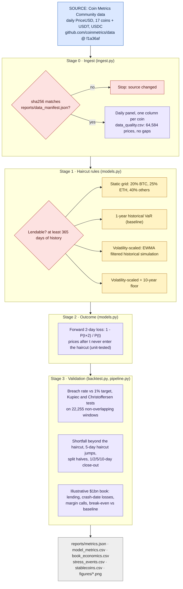
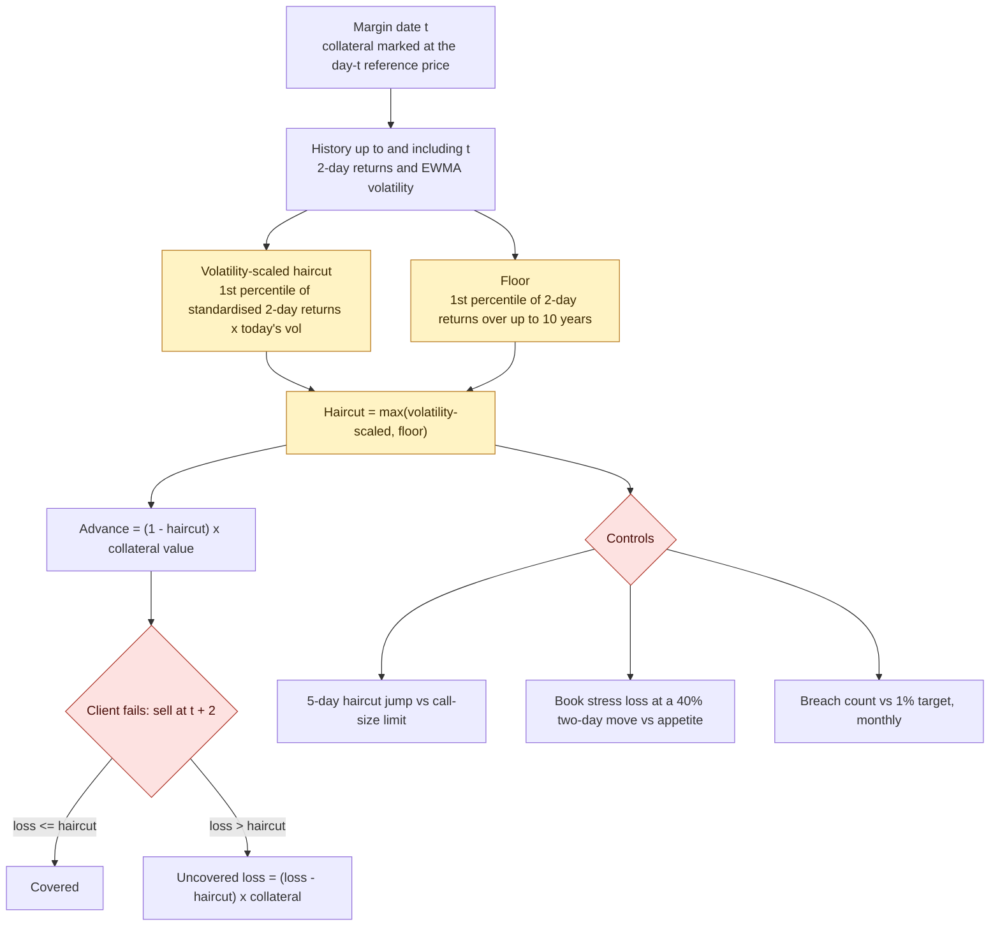
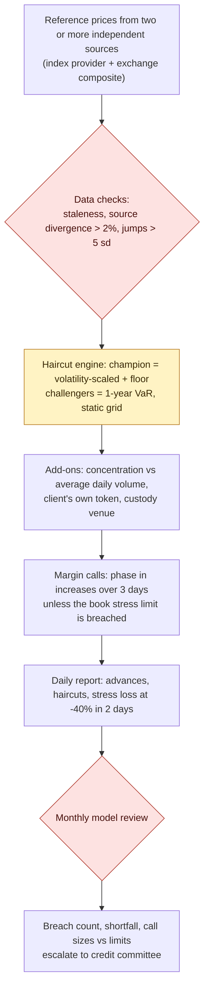

# How this project works

Three diagrams:
1. **Pipeline**: every step, its source file, and the logic inside it.
2. **Daily haircut decision**: how one margin date becomes a haircut, an advance and a scored outcome.
3. **Production design**: how the same logic would run as a daily collateral-risk process. This is a proposed design and is not implemented in this repo.

Colour key: **blue** = external data source · **lavender** = code step (file named in the box) · **yellow** = model · **red** = check or gate · **grey** = output

## 1. Pipeline (what `make all` runs)

## 2. Daily haircut decision

## 3. Production design (proposed, not implemented)

